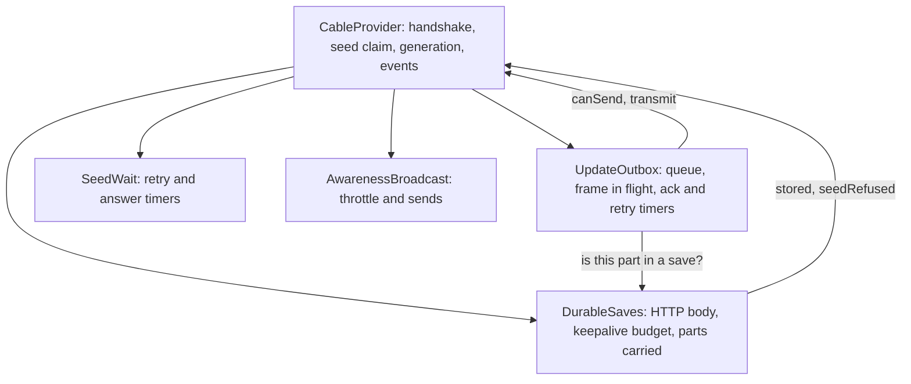

# Cable Provider Modules - Plan

## Goal Capsule

- **Objective:** Someone changing how the editor saves or syncs can do it without risking unrelated parts of that path, and people editing a document notice no difference.
- **Means:** Move four cohesive parts of `app/frontend/editor/cable_provider.ts` into modules beside it (KTD1).
- **Authority:** R-IDs win over KTDs, and KTDs win over units.
- **Execution profile:** One PR. Tests for uncovered behaviour come first and must pass on the unchanged code.
- **Stop conditions:** Stop if a part cannot move without changing order, timing or accounting, or if the result is not clearly simpler.
- **Finishing:** The caller simplifies, reviews and opens the PR.

## Product Contract

### Summary

`CableProvider` keeps its public surface and coordinates four modules: the outbox, HTTP saves, the wait for a seed, and awareness. Wire encoding and message types get their own files.

### Problem Frame

The 867-line class mixes four timers, unacked-edit accounting, keepalive accounting, presence and the handshake. It changes often and carries unsaved edits, so an unrelated change can break saving.

### Requirements

**Behaviour**

- R1. Exported names, events, wire messages, message order, timer durations and log messages stay the same.
- R2. Ack accounting, retry backoff, flush on unload and the page-wide keepalive budget stay the same.
- R3. Members read outside the class stay readable, including the `inFlight` and `queued` fields and `handleUnload` that tests use.

**Verification**

- R4. `test/frontend/cable_provider.test.mjs` is unchanged and passes.
- R5. Each moved behaviour that no test covers gets a test that passes before the move and fails under a mutation.

### Scope Boundaries

- Bugs found are reported, not fixed.
- `app/frontend/editor/snapshots.ts`, the server and the browser checks are not changed.

## Planning Contract

### Key Technical Decisions

- KTD1. **Split by state owner.** Each module owns the fields and timers it alone changes. The seed claim, held peer updates, generation and handshake stay in the provider, because one handshake decides across all of them.
- KTD2. **The outbox asks one question before sending.** It receives a `canSend` callback and a `transmit` callback. `canSend` covers destroyed, discarded, read-only and unsynced. `scheduleRetry` omits two of these today, but nothing is queued on a read-only provider and nothing is in flight after a discard.
- KTD3. **Acknowledging and sending stay separate calls.** The provider settles the seed claim between them, as it does today.
- KTD4. **HTTP saves keep one promise chain and report through callbacks.** An added `await` would move the outcome to a later microtask.
- KTD5. **The keepalive total stays module-level,** because providers on one page share it.
- KTD6. **`inFlight` and `queued` become read-only accessors** on the provider (R3).

### High-Level Technical Design

## Implementation Units

### U1. Cover the timing and order nothing tests

- **Goal:** Pin behaviours that the move could change unnoticed.
- **Requirements:** R5
- **Dependencies:** none
- **Files:** `test/frontend/cable_provider_timing.test.mjs`
- **Approach:** Drive `CableProvider` through its public surface with mocked timers. This seam catches order, timers and frames. It misses real browser unload behaviour, which the browser checks cover.
- **Test scenarios:**
  - Retries double from the base delay and stop growing at the maximum. An ack starts the delay over.
  - A disconnect during a backoff cancels that retry, and the reconnect sends the edit once.
  - A refused update is dropped and the next queued edit goes out at once.
  - An unanswered seed request is repeated after the ack timeout plus the retry delay.
  - Awareness changes within 100 ms become one frame at the end of that window. Leaving and blur send at once.
  - A disconnect drops a throttled awareness change.
  - A reconnect's subscription identifier carries the current generation, checksum and state vector.
  - An ack applies held peer updates before the next frame is sent.
- **Verification:** All pass on the unchanged provider.

### U2. Move wire encoding and limits

- **Goal:** Base64, empty-update and size-limit helpers and the message type live outside the class.
- **Requirements:** R1
- **Dependencies:** U1
- **Files:** `app/frontend/editor/sync_wire.ts`, `app/frontend/editor/cable_provider.ts`
- **Test scenarios:** `Test expectation: none -- existing limit and frame tests cover these helpers.`
- **Verification:** R4 and U1 tests pass.

### U3. Move the outbox

- **Goal:** One class owns queued parts, the frame in flight, its number and both timers.
- **Requirements:** R1, R2, R3
- **Dependencies:** U2
- **Files:** `app/frontend/editor/update_outbox.ts`, `app/frontend/editor/cable_provider.ts`
- **Approach:** Per KTD2, KTD3 and KTD6. The three copies of "clear ack timer, drop the frame, reset backoff" become one method.
- **Test scenarios:** U1's retry, disconnect and refusal scenarios, and the existing outbox tests.
- **Verification:** Mutating order, backoff, sequence or timer handling fails a test.

### U4. Move HTTP saves

- **Goal:** One class builds the save body, chooses keepalive and tracks which parts a save carries.
- **Requirements:** R1, R2
- **Dependencies:** U3
- **Files:** `app/frontend/editor/durable_saves.ts`, `app/frontend/editor/cable_provider.ts`
- **Approach:** Per KTD4 and KTD5.
- **Test scenarios:** The existing keepalive, overlap and pagehide tests.
- **Verification:** Mutating either accounting step or unload gate fails a test.

### U5. Move the seed wait and awareness

- **Goal:** Each timer pair lives with its state, and the two copies of the throttle reset become one.
- **Requirements:** R1
- **Dependencies:** U2
- **Files:** `app/frontend/editor/seed_wait.ts`, `app/frontend/editor/awareness_broadcast.ts`, `app/frontend/editor/cable_provider.ts`
- **Test scenarios:** U1's seed and awareness scenarios.
- **Verification:** Mutating either timer or the immediate-send rule fails a test.

### U6. Name the handshake steps

- **Goal:** The message switch reads as a dispatch, with the handshake in its own method.
- **Requirements:** R1
- **Dependencies:** U3, U5
- **Files:** `app/frontend/editor/cable_provider.ts`
- **Approach:** Keep the order of the checks and their early exits.
- **Test scenarios:** The existing handshake and seed tests.
- **Verification:** R4 and U1 tests pass.

## Verification Contract

| Check | Proves |
|---|---|
| `node --test test/frontend/cable_provider.test.mjs test/frontend/cable_provider_timing.test.mjs` | R1 to R5 |
| `npm run check` | Types and lint |
| One mutation per moved behaviour, each restored | R5 |

## Definition of Done

- Every requirement holds, and the existing test file has no diff.
- The provider is clearly shorter, and no module reaches into another's fields.
- No abandoned code or mutation is left in the diff.
